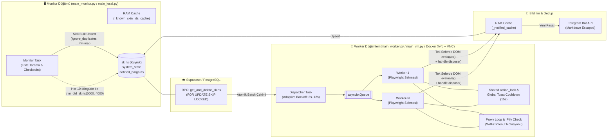

# 🕷️ Python Dağıtık Web Scraping & Otomasyon Botu Agent Paketi
**(Graphify + Addy Osmani Agent-Skills + Ponytail + Playwright Stealth + Supabase IO + Docker/Xvfb Uzmanlık Paketi)**

> [!IMPORTANT]
> Bu klasör (`python-scraping-bot`), **Playwright + Stealth + Dinamik Proxy + Supabase/PostgreSQL (`FOR UPDATE SKIP LOCKED`) + Docker (`Xvfb`/`x11vnc`) + Telegram Bot API** mimarisiyle çalışan 7/24 dağıtık veri kazıma (scraping) ve fırsat yakalama (monitoring/sniper) botları için özel olarak tasarlanmış **izole Antigravity (AGY) Agent Orkestrasyon Paketidir**.

Bir bot projesinin kök dizinine kopyalandığı anda yapay zeka asistanına:
1. **Monitor + Dispatcher + Worker** dağıtık mimarisini bozmamayı,
2. **`asyncio` Event Loop'unu** senkron veritabanı/HTTP çağrılarıyla (`supabase-py`, `requests`) dondurmamayı (`await asyncio.to_thread`),
3. **Supabase Disk IO ve Kilitlenme (`57014 statement timeout`)** bütçesini RAM önbellekleri (`_known_skin_ids_cache`, `_notified_cache`), `FOR UPDATE SKIP LOCKED` RPC'leri, `returning="minimal"` ve agresif `autovacuum` ile korumayı,
4. **Playwright Bellek Sızıntılarını (`ElementHandle.dispose()`, `page.close()`)** ve **Global Rate-Limit / Toast Cooldown (`action_lock`)** kalkanlarını 7/24 çalışma disipliniyle yönetmeyi öğretir.

---

## 🗺️ 1. Hedef Bot Mimarisi ve Veri Akışı

Bu paketteki beceriler (`skills`) ve alt ajanlar (`agents`), aşağıdaki dağıtık bot topolojisini standart kabul eder ve korur:



---

## 📁 2. Klasör İçeriği ve Yapısı (26 Beceri, 4 Alt Ajan)

```text
python-scraping-bot/
├── AGENTS.md                                      # Bot mimarisi ana orkestrasyon ve Ponytail çakışma kuralları
├── README.md                                      # Bu detaylı mimari ve kullanım kılavuzu
└── .agents/
    ├── rules/
    │   ├── graphify.md                            # Kod okumadan önce AST bilgi grafiği sorgulama kuralı
    │   └── ponytail.md                            # Bot mimarisini koruyan "Tembel Kıdemli Yazılımcı" kuralı
    ├── workflows/
    │   └── graphify.md                            # /graphify iş akışı
    ├── agents/                                    # 4 Uzman Alt Ajan (Subagents)
    │   ├── scraper-resilience-auditor.md          # ⭐ 7/24 Bot Dayanıklılık, Bellek Sızıntısı, Disk IO ve Ban Denetçisi
    │   ├── code-reviewer.md                       # Kıdemli kod kalitesi ve mimari inceleme uzmanı
    │   ├── security-auditor.md                    # .env, OAuth oturum, proxy ve injection güvenlik denetçisi
    │   └── test-engineer.md                       # Parser, regex, fiyat/float hesaplama ve mock test uzmanı
    └── skills/                                    # 26 Seçilmiş Beceri (18 Çekirdek + 8 Scraping/DB Uzmanlık)
        ├── distributed-scraper-architecture/      # ⭐ Monitor+Dispatcher+Worker, asyncio.to_thread, RAM Cache, Telegram
        ├── playwright-stealth-and-evasion/        # ⭐ Stealth, Route Block, Toast Cooldown, Single-Eval, Proxy, Docker Xvfb
        ├── supabase-postgres-best-practices/      # 🌐 [GitHub: supabase/agent-skills] SKIP LOCKED, Upsert, Autovacuum (14 ref)
        ├── web-scraping/                          # 🌐 [GitHub: bcharleson/webscraping-skill] Uzun süreli kazıma & pipeline
        ├── playwright-py-skill/                   # 🌐 [GitHub: akaihola/playwright-py-skill] Python Playwright & Locator API
        ├── scrapling-official/                    # 🌐 [GitHub: D4Vinci/Scrapling] Anti-bot aşma, stealth & adaptif parser
        ├── crawl4ai/                              # 🌐 [GitHub: brettdavies/crawl4ai-skill] JS-ağır SPA kazıma & anti-detection
        ├── browser-testing-with-devtools/         # 🌐 [GitHub: addyosmani/agent-skills] Canlı DOM ve ağ inceleme
        ├── graphify/                              # AST tabanlı proje bilgi grafiği
        ├── ponytail/ (+ 5 alt komut becerisi)     # Minimal diff disiplini (audit, review, debt, gain, help)
        └── [11 Addy Osmani Mühendislik Becerisi]  # interview-me, spec, planning, incremental, tdd, debugging, vb.
```

---

## 🧠 3. 4 Aşamalı Çalışma Sistemi (Kim Ne İş Yapar?)

| Aşama | Yöneten Sistem | Bot Projelerindeki Görevi |
| :--- | :--- | :--- |
| **1. Keşif & Bağlam** | **`Graphify`** | Dosyaları rastgele okumadan önce `graphify-out/graph.json` grafiğini sorgular. `scraper.py`, `database.py` ve `main_*.py` içindeki mevcut fonksiyonları bulur; aynı regex, DB yardımcısı veya Telegram fonksiyonunun ikinci kez yazılmasını önler. |
| **2. Analiz & Planlama** | **`addyosmani/agent-skills` + `web-scraping`** | Hedef sitenin DOM yapısı, rate-limit sınırları veya filtreleme kuralları belirsizse `@interview-me` ile netleştirir, `@planning-and-task-breakdown` ile işi güvenli adımlara böler. |
| **3. Kod Yazımı (Diff Disiplini)** | **`Ponytail` + 8 Scraping Becerisi** | Gereksiz soyutlamaları yasaklar **AMA** botun yaşam damarları olan `Monitor`/`Dispatcher`/`Worker` ayrımına, `FOR UPDATE SKIP LOCKED` kuyruğuna, RAM önbelleklerine, `action_lock` cooldown mekanizmasına ve `handle.dispose()` temizliğine **asla dokunmaz**. |
| **4. 7/24 Dayanıklılık & Denetim** | **`scraper-resilience-auditor` + `Ponytail`** | Kodu teslim etmeden önce `asyncio` event-loop blokajlarını, açık unutulan Playwright sekmelerini/handle'larını, Supabase Disk IO sızıntılarını ve Telegram Markdown kaçış (`escape`) hatalarını denetler. |

---

## 🌐 4. GitHub'dan Seçilen ve Özelleştirilen 8 Scraping Uzmanlık Becerisi

### 1. `@distributed-scraper-architecture` *(Botunuzun Çekirdek Mimari Becerisi)*
- **Kapsamı:** `main_monitor.py`, `main_worker.py`, `main_local.py`, `main_vm.py`, `database.py`, `telegram_bot.py`, `setup_supabase.sql`, `supabase_optimizasyon.sql`.
- **Öğrettiği Kurallar:**
  - **Üçlü Görev Ayrımı:** `monitor_task` (üretici), `dispatcher_task` (adaptif backoff'lu kuyruk çekici) ve `worker_task` (tüketici) yapısını korur.
  - **Atomik Kuyruk (`FOR UPDATE SKIP LOCKED`):** Çoklu VM ve Docker konteynerlerinin birbirini bloklamadan ve `57014 statement timeout` hatası almadan `get_and_delete_skins` RPC fonksiyonuyla iş çekmesini sağlar.
  - **Bloklamayan Async DB/HTTP:** Senkron `supabase-py` ve `requests` çağrılarını zorunlu olarak `await asyncio.to_thread(...)` içine alır.
  - **Supabase Disk IO Kalkanı:** `httpx.Client` üzerinde `http2=False` ve `10.0s` kesin timeout yaması, `_known_skin_ids_cache` ve `_notified_cache` RAM önbellekleri, 60 saniyede bir throttle edilen `last_scanned_id` yazımı, 50'şerli Bulk Upsert (`ignore_duplicates=True, returning="minimal"`), `trim_old_skins(5000, 4000)` ve `autovacuum_vacuum_scale_factor = 0.02`.
  - **Telegram Güvenliği:** Ürün ve satıcı isimlerindeki tüm özel karakterlerin (`_`, `*`, `[`, `]`, vb.) `_escape_markdown()` ile kaçırılması.

### 2. `@playwright-stealth-and-evasion` *(Tarayıcı, Proxy, Cooldown & Docker Xvfb Becerisi)*
- **Kapsamı:** `scraper.py`, `proxy_manager.py`, `facebook_auth.py`, `Dockerfile`, `docker-compose.yml`, `start_worker.sh`.
- **Öğrettiği Kurallar:**
  - **Kalıcı Profil & Stealth:** `launch_persistent_context` (`ChromeProfilePlaywright`), `--disable-blink-features=AutomationControlled` ve `Stealth().apply_stealth_async(context)`.
  - **Kaynak Engelleme:** `image`, `media`, `font` (ve opsiyonel `stylesheet`) isteklerini `route.abort()` ile keserek proxy trafiğini ve CPU kullanımını düşürme.
  - **Kilit İçi Global Cooldown:** `self.action_lock = asyncio.Lock()` içinde hem rastgele jitter (`GLOBAL_RATE_LIMIT_MIN`..`MAX`) hem de `.p-toast--error` yakalandığında tüm worker'ları aynı anda durduran `self.global_cooldown_until` kontrolü.
  - **Tek Seferde DOM `evaluate()` & Bellek Temizliği:** Satır içindeki satıcı, float (`0.\d{2,}`), StatTrak, fiyat ve buton görünürlüğünü 10 ayrı IPC çağrısı yerine **tek bir `row_handle.evaluate(...)`** içinde çekme ve iş bitiminde `await r["handle"].dispose()` + `finally: await worker_page.close()` ile bellek sızıntısını sıfırlama.
  - **Dinamik Proxy Döngüsü:** `random.shuffle(proxies)` ile konteyner çakışmasını önleme, `ipify` testi ve WAF/Timeout durumunda tarayıcıyı kapatıp yeni proxy ile ayağa kalkma.
  - **Docker Headful (`Xvfb + x11vnc + fluxbox`):** Headless yakalanmasını önlemek için sanal ekranda (`:99`) gerçek pencere çalıştırma, `/tmp/.X*-lock` temizliği ve `5901..5905` VNC portlarıyla canlı izleme.

### 3. `@supabase-postgres-best-practices` *(Kaynak: `github.com/supabase/agent-skills`)*
- Supabase ekibinin resmi PostgreSQL performans paketi. İçindeki `references/` klasöründe **14 derin teknik rehber** bulunur:
  - `lock-skip-locked.md`, `lock-deadlock-prevention.md`, `lock-short-transactions.md`
  - `data-batch-inserts.md`, `data-upsert.md`, `data-n-plus-one.md`, `data-pagination.md`
  - `conn-pooling.md`, `conn-limits.md`, `conn-idle-timeout.md`
  - `monitor-vacuum-analyze.md`, `query-composite-indexes.md`, `query-partial-indexes.md`, `query-missing-indexes.md`

### 4. `@web-scraping` *(Kaynak: `github.com/bcharleson/webscraping-skill`)*
- Uzun süreli çalışan kazıma işleri için operasyonel kalıplar, yarıda kalan taramaları kaldığı yerden devam ettirme (checkpoint/resume), paralel iş hattı orkestrasyonu ve kademeli rate-limit backoff stratejileri (`SKILL.md` + `REFERENCE.md`).

### 5. `@playwright-py-skill` *(Kaynak: `github.com/akaihola/playwright-py-skill`)*
- Python Playwright için kapsamlı seçici (locator) stratejileri, görünürlük/DOM bekleme kalıpları, popup/modal temizliği ve oturum doğrulama (login) akışları (`SKILL.md` + `API_REFERENCE.md`).

### 6. `@scrapling-official` *(Kaynak: `github.com/D4Vinci/Scrapling`)*
- Anti-bot / WAF korumalı sitelerde kademeli kazıma stratejileri, stealth oturum yönetimi, sayfa tasarımı değişse bile öğeleri bulabilen adaptif DOM ayrıştırma (`references/fetching/stealthy.md`, `references/parsing/adaptive.md`, `references/spiders/architecture.md`).

### 7. `@crawl4ai` *(Kaynak: `github.com/brettdavies/crawl4ai-skill`)*
- JavaScript ağırlıklı SPA sayfalarını kazıma, anti-detection katmanları (`references/anti-detection.md`), WAF/engel tırmanma matrisi (`references/escalation.md`) ve sorun giderme (`references/troubleshooting.md`).

### 8. `@browser-testing-with-devtools` *(Kaynak: `github.com/addyosmani/agent-skills`)*
- Hedef sitede bir seçici (selector) değiştiğinde veya beklenmedik bir ağ hatası alındığında Chrome DevTools üzerinden canlı DOM, konsol ve network incelemesi yapma disiplini.

---

## 🛡️ 5. Ponytail Çakışma Korumaları (`AGENTS.md` Garantileri)

Ponytail normalde *"en az kod, tek dosya, sıfır sarmalayıcı"* felsefesiyle çalışır. Ancak bir scraping botunda aşırı sadeleştirme botun banlanmasına veya veritabanının kilitlenmesine yol açar. Bu paketteki `AGENTS.md`, Ponytail'e şu **4 Kesin Sınırı** koyar:

1. **Dağıtık Rolleri Birleştiremez:** `main_monitor.py`, `main_worker.py`, `main_local.py` ve `main_vm.py` dosyalarını veya `monitor_task` / `dispatcher_task` / `worker_task` korutinlerini *"tek döngüde birleştirelim"* diyerek bozamaz.
2. **RAM Önbelleklerini ve IO Kalkanlarını Silemez:** `database.py` içindeki `_known_skin_ids_cache`, `_notified_cache`, `_last_scanned_id_cache`, `httpx` HTTP/1.1 yaması, `ignore_duplicates=True`, `returning="minimal"` ve `FOR UPDATE SKIP LOCKED` yapılarını *"fazladan kod"* diyerek kaldıramaz.
3. **`asyncio.to_thread` Sarmalayıcılarını Kaldıramaz:** `async def` içindeki senkron DB ve Telegram çağrılarını doğrudan çağıramaz.
4. **Cooldown Kilitlerini ve Bellek Temizliğini Atlayamaz:** `self.action_lock`, `global_cooldown_until`, `await handle.dispose()` ve `finally: await worker_page.close()` bloklarını kısaltamaz.

---

## 💬 6. Günlük Kullanımda Kopyala-Yapıştır Komut Şablonları

Antigravity sohbet ekranında doğrudan aşağıdaki komut kalıplarını kullanabilirsiniz:

### Senaryo 1: Yeni Bir Hedef Site veya Kategori İçin Bot Özelliği Eklerken
> **Komut:**  
> _"Şu özelliği/kategoriyi bota eklemek istiyorum: [Özelliği yazın]. Önce Graphify ile `scraper.py` ve `database.py` içindeki mevcut yapıyı kontrol et, `@distributed-scraper-architecture` ve `@playwright-stealth-and-evasion` kurallarına sadık kalarak `@planning-and-task-breakdown` ile planla ve Ponytail disipliniyle uygula."_

### Senaryo 2: Hedef Sitede HTML / CSS Seçicileri (Selectors) Değiştiğinde
> **Komut:**  
> _"Detay sayfasında fiyat / satıcı / sıralama seçicileri çalışmıyor: [Hata/Log]. `@playwright-stealth-and-evasion` ve `@playwright-py-skill` becerilerini kullanarak tek seferlik `evaluate()` yapısını ve `handle.dispose()` temizliğini bozmadan seçicileri güncelle."_

### Senaryo 3: Supabase Zaman Aşımı (`57014`) veya Yüksek Disk IO Sorunu Yaşandığında
> **Komut:**  
> _"Veritabanında yoğunluk veya timeout hatası alıyorum: [Log]. `database.py` ve `.sql` dosyalarını `@distributed-scraper-architecture` ve `@supabase-postgres-best-practices` ile incele; `FOR UPDATE SKIP LOCKED`, RAM cache, `returning='minimal'` ve `autovacuum` ayarlarını optimize et."_

### Senaryo 4: Bot 7/24 Çalışırken Şişiyor, Yavaşlıyor veya Donuyorsa (Tam Dayanıklılık Denetimi)
> **Komut:**  
> _"Tüm bot kodunu `scraper-resilience-auditor` alt ajanıyla ve `@ponytail-audit` ile tara; `asyncio` event-loop'u bloklayan senkron çağrıları, kapatılmayan Playwright sekmelerini/handle'larını, bellek sızıntılarını ve rate-limit risklerini önem sırasına göre raporla."_

### Senaryo 5: Rate Limit, Toast Hatası veya Proxy/WAF Engeli Artışında
> **Komut:**  
> _"Worker'lar çok sık rate-limit / WAF engeline takılıyor. `scraper.py`, `proxy_manager.py` ve `main_worker.py` dosyalarını `@playwright-stealth-and-evasion` ve `@scrapling-official` ile incele; `action_lock` içi global cooldown, jitter süreleri ve proxy rotasyon döngüsünü güçlendir."_

### Senaryo 6: Docker / VNC / Xvfb Konteyner Sorunlarında
> **Komut:**  
> _"Docker worker konteynerleri yeniden başlarken veya VNC ekranında sorun yaşıyorum: [Log]. `Dockerfile`, `docker-compose.yml` ve `start_worker.sh` dosyalarını `@playwright-stealth-and-evasion` kurallarıyla kontrol et ve düzelt."_

### Senaryo 7: Son Değişiklikleri Canlıya Almadan Önce İnceletme (Code Review)
> **Komut:**  
> _"Son yaptığımız değişiklikleri `@ponytail-review`, `@code-review-and-quality` ve `scraper-resilience-auditor` ile incele; gereksiz kod, event-loop blokajı veya Disk IO sızıntısı var mı raporla."_

---

## 🚀 7. Yeni Bir Scraping Bot Projesine 10 Saniyede Nasıl Entegre Edilir?

Yeni veya mevcut herhangi bir Python bot projenizin kök dizinine bu paketi **tek komutla** entegre edebilirsiniz:

```bash
# 1. Paketteki AGENTS.md ve .agents/ klasörünü bot projenizin kök dizinine kopyalayın:
cp -r "/home/murathan_akkus/Desktop/New Folder 2/All-Sklills/python-scraping-bot/." /yeni/bot/projesi/yolu/

# 2. Hedef bot projesinde ilk AST bilgi grafiğini oluşturun ve otomatik git hook'unu kurun:
cd /yeni/bot/projesi/yolu/
graphify update .
graphify hook install
```

> [!TIP]
> Kopyalama işleminden sonra bot projenizi Antigravity ile açtığınız anda `AGENTS.md`, 26 beceri (`skills`) ve `scraper-resilience-auditor` dahil 4 alt ajan (`subagents`) ekstra hiçbir ayara gerek kalmadan otomatik olarak devreye girer!
